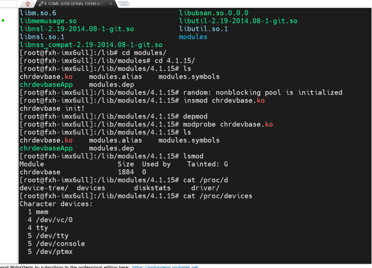
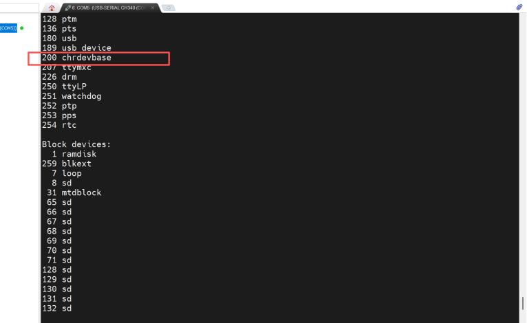
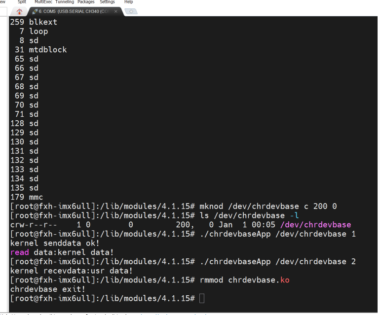

# chrdevbase 字符设备驱动实验

> 对应实践：
> 编写字符设备驱动框架（file_operations）→ 注册设备号 → 编译生成 ko → 开发板加载驱动 → 创建设备节点 → 用户态 APP 读写测试 → 卸载驱动。
> 核心链路：
> **写驱动 → make 编译 ko → insmod 加载 → mknod 建设备节点 → APP 读写测试 → rmmod 卸载**
> 前置依赖：根文件系统已通过 NFS 挂载，开发板能进入 shell；本章完成第一个 Linux 字符设备驱动。


***

## 一、字符设备驱动简介

### 1. 什么是字符设备


* 英文全称：**Character Device**，按字节流顺序读写的设备（串口、按键、LED、I2C 传感器等）。

* **为什么需要驱动**：应用层不能直接操作硬件，必须通过内核驱动程序间接访问。字符设备驱动就是内核和应用层之间的桥梁。

### 2. 驱动开发核心框架


| 组成                            | 作用                                     |
| ----------------------------- | -------------------------------------- |
| `file_operations`             | 文件操作结构体，把应用层 open/read/write 映射到驱动里的函数 |
| `register_chrdev`             | 向内核注册字符设备，绑定主设备号                       |
| `unregister_chrdev`           | 注销设备，释放设备号                             |
| `module_init` / `module_exit` | 驱动入口 / 出口，insmod 时跑 init，rmmod 时跑 exit |

> 一句话：字符设备驱动 = 
>
> **一张操作表（fops）+ 注册 + 注销**


***

## 二、实验内容

### 实验目标

编写 chrdevbase 字符设备驱动：


* 主设备号：**200**

* 设备名：**chrdevbase**

* 实现 open、read、write、release 四个基本操作

* 配套测试 APP：用户态读写验证

### 文件结构


```
chrdevbase/
├── chrdevbase.c      # 驱动源码
├── chrdevbaseApp.c   # 测试应用
├── Makefile          # 编译脚本
└── README.md
```


***

## 三、驱动编写要点

### 1. 核心框架（重点）


```
// 头文件
#include <linux/module.h>
#include <linux/fs.h>
#include <linux/init.h>
#include <linux/uaccess.h>

#define CHRDEVBASE_MAJOR 200

// open/read/write/release 四个函数实现...

// 文件操作结构体
static struct file_operations chrdevbase_fops = {
    .owner   = THIS_MODULE,
    .open    = chrdevbase_open,
    .release = chrdevbase_release,
    .read    = chrdevbase_read,
    .write   = chrdevbase_write,
};

// 入口：注册设备
static int __init chrdevbase_init(void)
{
    register_chrdev(CHRDEVBASE_MAJOR, "chrdevbase", &chrdevbase_fops);
    return 0;
}

// 出口：注销设备
static void __exit chrdevbase_exit(void)
{
    unregister_chrdev(CHRDEVBASE_MAJOR, "chrdevbase");
}

module_init(chrdevbase_init);
module_exit(chrdevbase_exit);
MODULE_LICENSE("GPL");
```

**逐行理解：**


| 代码                                          | 作用                                  |
| ------------------------------------------- | ----------------------------------- |
| `.owner = THIS_MODULE`                      | 模块引用计数保护，防止使用中被 rmmod 卸载            |
| `.open = chrdevbase_open`                   | 应用层 open () → 驱动里的 chrdevbase\_open |
| `.read = chrdevbase_read`                   | 应用层 read () → 驱动里的 chrdevbase\_read |
| `register_chrdev(200, "chrdevbase", &fops)` | 告诉内核：200 号设备，用我这张操作表                |
| `unregister_chrdev(200, "chrdevbase")`      | 注销设备，释放设备号                          |

### 2. 内核与用户空间数据传递

驱动里不能直接访问用户空间内存，必须用内核提供的函数：


| 函数                                     | 方向      | 作用              |
| -------------------------------------- | ------- | --------------- |
| `copy_to_user(buf, kerneldata, cnt)`   | 内核 → 用户 | 把内核数据 copy 给应用层 |
| `copy_from_user(kerneldata, buf, cnt)` | 用户 → 内核 | 把应用层数据 copy 进内核 |


***

## 四、编译与测试

### 1. 编译驱动（Ubuntu 虚拟机）


```
make
```

生成 `chrdevbase.ko` 内核模块文件。

### 2. 编译测试 APP（Ubuntu 虚拟机）


```
arm-linux-gnueabihf-gcc chrdevbaseApp.c -o chrdevbaseApp
```

### 3. 开发板加载与测试

**① 加载驱动模块：**


```
insmod chrdevbase.ko
```

验证：`lsmod` 能看到 chrdevbase 模块；`cat /proc/devices` 能看到字符设备号 200，名称 chrdevbase。







**② 创建设备节点：**


```
mknod /dev/chrdevbase c 200 0
```


* `c`：字符设备

* `200`：主设备号

* `0`：次设备号

**③ 运行测试程序：**


```
# 写数据到驱动
./chrdevbaseApp /dev/chrdevbase 1

# 从驱动读数据
./chrdevbaseApp /dev/chrdevbase 2
```

成功标志：串口打印 kernel senddata ok /kernel recvdata ok。




**④ 卸载驱动：**


```
rmmod chrdevbase
```


***

## 五、常见坑


| 现象                                    | 原因                            | 解决                               |
| ------------------------------------- | ----------------------------- | -------------------------------- |
| insmod 报错：module version mismatch     | ko 的内核版本和开发板运行的内核不一致          | 确认 Makefile 里 KERNELDIR 对应正确内核源码 |
| open 设备失败：No such file or directory   | 没 mknod 创建设备节点                | 执行 mknod /dev/chrdevbase c 200 0 |
| insmod 后 /proc/devices 里没有 chrdevbase | register\_chrdev 没成功 / 设备号被占用 | 换一个设备号试试                         |
| rmmod chrdevbase.ko 报错                | rmmod 后面不能带 .ko               | 写 rmmod chrdevbase               |
| 警告：license unspecified taints kernel  | 没写 MODULE\_LICENSE ("GPL")    | 驱动末尾加上 MODULE\_LICENSE ("GPL")   |


***

## 六、本章小结


1. 字符设备驱动核心：**file\_operations 操作表 + register\_chrdev 注册 + unregister\_chrdev 注销**。

2. 应用层系统调用和驱动函数一一对应：open→open、read→read、write→write、close→release。

3. 加载流程：insmod ko → mknod 建设备节点 → APP 打开 /dev/ 设备名 读写。

4. 内核和用户空间不能直接访问内存，用 `copy_to_user` / `copy_from_user` 传递数据。

5. 卸载流程：rmmod 模块名（不带 .ko）。

**一句话概括**：写驱动框架 → make 编译 ko → 板子上 insmod 加载 → mknod 建设备节点 → APP 读写测试 → rmmod 卸载。


***

## 附：路径速查


| 内容     | 说明              |
| ------ | --------------- |
| 硬件平台   | 正点原子 IMX6ULL    |
| 内核版本   | Linux 4.1.15    |
| 主设备号   | 200             |
| 设备节点   | /dev/chrdevbase |
| 驱动模块   | chrdevbase.ko   |
| 测试 APP | chrdevbaseApp   |