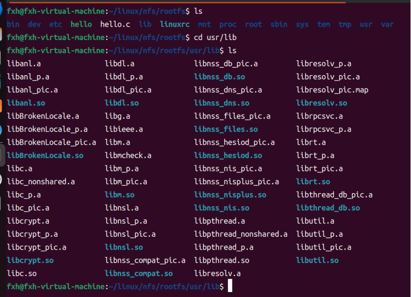
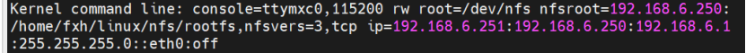
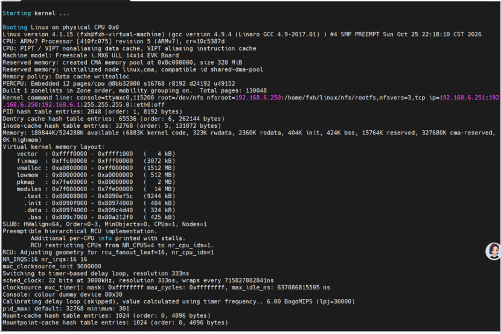
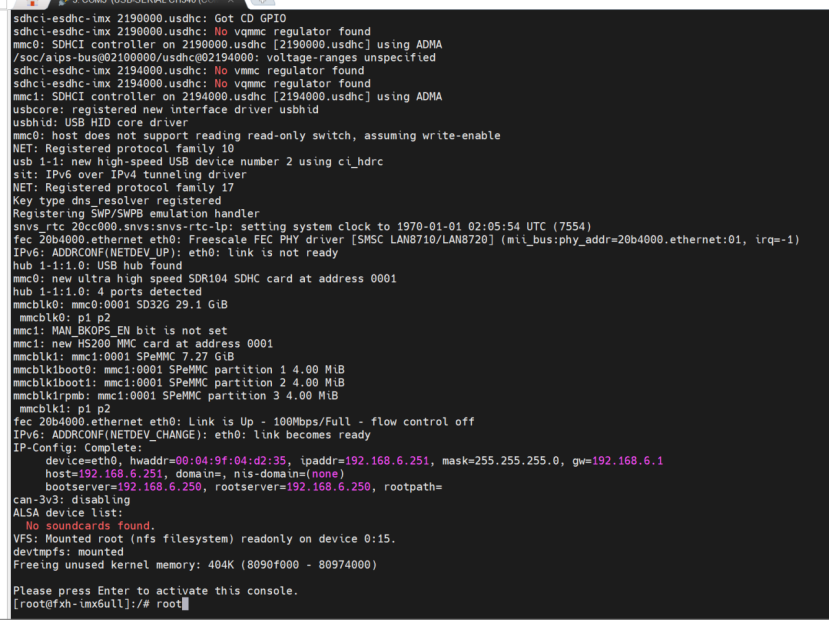
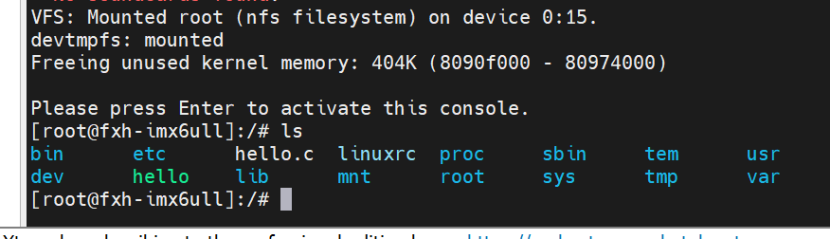

# BusyBox 构建 Linux 根文件系统

> 对应实践：
> 下载编译 BusyBox → 向 rootfs 添加 lib 库 → 创建标准目录 → Ubuntu 配置 NFS → U-Boot 设置 bootargs → 开发板 NFS 挂载 rootfs 初步测试 → 完善 /etc 配置（rcS、fstab、inittab）→ 软件运行 / 中文字符 / 开机自启动测试。
> 核心链路：
> **编译 BusyBox → 拷 lib → 建目录 → NFS 挂载测试 → 完善 etc 三件套 → 功能测试**
> 前置依赖：U-Boot、内核移植已完成，内核能通过 TFTP 下载并用 bootz 启动；本章解决启动时卡在
>
> `VFS: Unable to mount root fs`的问题。


***

## 一、根文件系统简介

### 1. 根文件系统是什么


* 英文全称：**Root File System（rootfs）**，是内核挂载的**第一个文件系统**。

* **为什么必须有**：内核只是系统核心，用户程序（init、ls、ifconfig…）全部存放在 rootfs 里。之前内核启动笔记讲过：`kernel_init` 要做 "挂载根文件系统 → 运行用户 init 程序" 才能进入用户态。**没有 rootfs，内核只能 panic（崩溃）。**

### 2. rootfs 的组成


| 组成    | 内容                        | 提供方     |
| ----- | ------------------------- | ------- |
| 命令工具  | ls、cp、ifconfig 等几百个命令     | BusyBox |
| C 运行库 | libc、ld-linux 等共享库        | 交叉编译器   |
| 配置文件  | inittab、fstab、rcS、profile | 手动创建    |
| 应用程序  | 自己写的程序、驱动模块               | 用户      |

> 一句话：rootfs =
> **BusyBox 命令 + 库 + etc 配置 + 应用程序**


***

## 二、BusyBox 构建根文件系统

### BusyBox 简介


* BusyBox = 嵌入式 Linux 的 "瑞士军刀"：一个可执行文件集成几百个常用命令，通过软链接（symlink）调用，体积小。

* `bin/`、`sbin/`、`usr/bin/`、`usr/sbin/` 下的命令基本都是指向 busybox 的软链接。

### 编译 BusyBox（重点）

**① 修改顶层 Makefile**（指定架构和交叉编译器）：


```
ARCH ?= arm
CROSS_COMPILE ?= arm-linux-gnueabihf-
```


* `?=`：命令行没传该变量时才用默认值（与内核移植笔记相同）。

* CROSS\_COMPILE：交叉编译前缀（Cross Compile，在 x86 电脑上编译 ARM 程序必须指定）。

**② 图形化配置：**


```
make menuconfig
```

要点（正点原子教程配置）：


* Settings → **Cross compiler prefix**：填 `arm-linux-gnueabihf-`

* Settings → **Build static binary (no shared libs)**：默认不勾 = **动态链接**（体积小，但运行时要依赖 lib 库 → 所以下面必须拷库）

* Settings → **Don't use /usr**：勾选，防止 make install 误装到主机 /usr

* 保存退出，生成 `.config`

**③ 编译并安装到 rootfs：**


```
make -j4
make CONFIG_PREFIX=/home/fxh/linux/nfs/rootfs install
```


* CONFIG\_PREFIX：安装目的地，直接把 BusyBox 装进 rootfs

* 产物：`bin/`、`sbin/`、`usr/bin/`、`usr/sbin/`

### 向根文件系统添加 lib 库（重点，漏了起不来）

动态链接的 busybox 运行时需要交叉编译器的 libc 共享库，必须拷进 rootfs：


```
cp -d /path/to/交叉编译器/arm-linux-gnueabihf/libc/lib/*.so*     /home/fxh/linux/nfs/rootfs/lib/
cp -d /path/to/交叉编译器/arm-linux-gnueabihf/libc/usr/lib/*.so* /home/fxh/linux/nfs/rootfs/usr/lib/
```


* `-d`：**保留软链接**（很多库是 .so → .so.1 的软链，不用 -d 会拷成内容副本、链接失效）

* 路径中的 "交叉编译器" 要替换成你自己的安装路径

* 验证：板子上 `ldd /bin/busybox` 看 Missing 哪些库

* 还要有动态链接器 `ld-linux-armhf.so``.3`（拷整个 lib 目录一般就带上）




### 创建其他文件夹


```
mkdir -p /home/fxh/linux/nfs/rootfs/{bin,dev,etc,lib,proc,sbin,sys,tmp,usr,mnt,var,root}
```


* `{a,b,c}`：大括号展开，一条命令建多个目录

* 各目录作用：


| 目录              | 作用                                |
| --------------- | --------------------------------- |
| /proc /sys /dev | 虚拟文件系统挂载点，开机后由 fstab/rcS 挂上，内容不落盘 |
| /lib            | 共享库（拷库步骤放入的）                      |
| /etc            | 配置文件（下一节创建）                       |
| /usr /bin /sbin | busybox 命令                        |


***

## 三、根文件系统初步测试（NFS 挂载）

### 1. Ubuntu 端：配置 NFS 服务


```
sudo apt install nfs-kernel-server
```

编辑 `/etc/exports`，添加：


```
/home/fxh/linux/nfs/rootfs  *(rw,sync,no_root_squash,no_subtree_check)
```

生效并检查：


```
sudo exportfs -arv
showmount -e localhost
```


| 参数                   | 含义                            |
| -------------------- | ----------------------------- |
| rw                   | 可读可写                          |
| sync                 | 同步写，保证数据落盘                    |
| **no\_root\_squash** | 关键！保留开发板 root 权限；不加会权限不足、挂载失败 |
| no\_subtree\_check   | 关闭子树检查，提升稳定性                  |

### 2. U-Boot：设置 bootargs（重点，注意格式）


```
setenv bootargs 'console=ttymxc0,115200 rw root=/dev/nfs nfsroot=192.168.6.250:/home/fxh/linux/nfs/rootfs,nfsvers=3,tcp ip=192.168.6.251:192.168.6.250:192.168.6.1:255.255.255.0::eth0:off'
boot
```

**整条拆解表：**


| 段                                                              | 含义                       |
| -------------------------------------------------------------- | ------------------------ |
| console=ttymxc0,115200                                         | 串口控制台：UART0，波特率 115200   |
| rw                                                             | 根文件系统以读写方式挂载             |
| root=/dev/nfs                                                  | 根文件系统来自 NFS              |
| nfsroot=192.168.6.250:/home/fxh/linux/nfs/rootfs,nfsvers=3,tcp | NFS 服务器 IP + 共享路径 + 挂载选项 |
| ip=...                                                         | 开发板网络配置（见下）              |

**nfsroot 两个重点选项（**`tcp`**&#x20;是这次特别加上的）：**


* `nfsvers=3`：强制使用 **NFSv3 协议**。Ubuntu 新版默认 NFSv4，开发板内核常不兼容，**不加容易挂载失败**。

* `tcp`：使用 **TCP 传输协议**（Transmission Control Protocol，有确认和重传机制，比 UDP 可靠；NFS 默认可走 UDP，嵌入式挂载推荐显式写 tcp）。

**ip 字段逐段拆解（完整格式）：**

`ip=<client-ip>:<server-ip>:<gw-ip>:<netmask>:<hostname>:<device>:<autoconf>`


| 段         | 本例值             | 含义                    |
| --------- | --------------- | --------------------- |
| client-ip | 192.168.6.251   | 开发板自己的 IP             |
| server-ip | 192.168.6.250   | NFS 服务器（Ubuntu）IP     |
| gw-ip     | 192.168.6.1     | 默认网关（Default Gateway） |
| netmask   | 255.255.255.0   | 子网掩码                  |
| hostname  | （空，两个冒号连着 = 跳过） | 主机名                   |
| device    | eth0            | 使用的网卡                 |
| autoconf  | off             | 关闭自动配置（不用 DHCP，全手动）   |

> 为什么 ip 字段要写全：NFS 挂载前板子必须先有 IP 才能找到服务器；
> `off`
> 表示不用 DHCP 自动获取。




### 3. 启动验证（成功标志）

串口出现：


```
VFS: Mounted root (nfs filesystem) on device 0:15.
```

最后出现 `#` 或 `/ #` 提示符，能敲 ls、ifconfig = 初步成功。







### 4. 常见坑（重点记）


| 现象                                          | 原因                 | 解决                                       |
| ------------------------------------------- | ------------------ | ---------------------------------------- |
| `VFS: Unable to mount root fs`              | rootfs 没挂上         | 查 exports、no\_root\_squash、nfsvers=3、路径  |
| 卡在 `Starting kernel...`                     | console 没配 / 内核没起来 | 查 bootargs                               |
| `nfs: server not responding` / RPC time out | 板子和 Ubuntu 网络不通    | ping 192.168.6.250；查网卡驱动（内核移植笔记的 smsc.c） |
| 挂载成功但没有控制台                                  | rcS 没执行权限          | chmod +x rcS                             |


***

## 四、完善根文件系统

### 创建 /etc/init.d/rcS（开机自启动脚本，重点）

位置：`rootfs/etc/init.d/rcS`


```
#!/bin/sh
PATH=/sbin:/bin:/usr/sbin:/usr/bin
runlevel=S
prevlevel=N
umask 022
export PATH runlevel prevlevel

mount -a
mkdir -p /dev/pts
mount -t devpts devpts /dev/pts
echo /sbin/mdev > /proc/sys/kernel/hotplug
mdev -s
```

逐行理解：


| 行                           | 作用                               |
| --------------------------- | -------------------------------- |
| `#!/bin/sh`                 | 指定脚本解释器（Shebang）                 |
| `PATH=...`                  | 命令搜索路径                           |
| `mount -a`                  | 读 /etc/fstab 把 /proc/sys/dev 全挂上 |
| `mkdir -p /dev/pts`         | 建虚拟终端挂载点                         |
| `mount -t devpts`           | 挂载 devpts（虚拟终端）                  |
| `echo /sbin/mdev > hotplug` | 设置内核热插拔通知给 mdev                  |
| `mdev -s`                   | 扫描生成 /dev 设备节点（嵌入式替代 udev）       |

> 记住：
> `chmod +x rcS`
> ！没有执行权限，开机脚本不运行，串口没有控制台（大坑）。

### 创建 /etc/fstab（挂载表）

位置：`rootfs/etc/fstab`


```
#<file system> <mount point> <type> <options> <dump> <pass>
proc     /proc     proc     defaults  0  0
sysfs    /sys      sysfs    defaults  0  0
tmpfs    /dev      tmpfs    defaults  0  0
tmpfs    /tmp      tmpfs    defaults  0  0
```


* 作用：rcS 里 `mount -a` 按这张表自动挂载

* 字段：设备 | 挂载点 | 类型 | 选项 | dump 备份 | pass 开机自检顺序

### 创建 /etc/inittab（init 进程配置）

位置：`rootfs/etc/inittab`


```
::sysinit:/etc/init.d/rcS
::respawn:/sbin/getty 115200 ttymxc0
::restart:/sbin/init
::shutdown:/bin/umount -a -r
::shutdown:/sbin/swapoff -a
```


* 格式：`<id>:<action>:<process>`


| 行                                      | 作用                        |
| -------------------------------------- | ------------------------- |
| `::sysinit:/etc/init.d/rcS`            | 系统初始化时执行 rcS              |
| `::respawn:/sbin/getty 115200 ttymxc0` | 串口登录终端（respawn = 退出后自动重启） |
| `::restart:/sbin/init`                 | init 重启时执行                |
| `::shutdown:/bin/umount -a -r`         | 关机时卸载文件系统                 |
| `::shutdown:/sbin/swapoff -a`          | 关机时关闭交换分区                 |


***

## 五、根文件系统其他功能测试

### 软件运行测试


```
ls            # 看 rootfs 目录
ifconfig eth0 # 看 IP
df -h         # 看各文件系统挂载和容量
ps            # 看进程：init、getty 在跑
```

确认 busybox 命令都能用、/proc/sys 挂载正常。




### 中文字符测试


* 创建中文文件名 / 目录，`ls` 看能否正常显示（依赖内核与 busybox 的 UTF-8 支持）

* 若显示乱码：检查终端编码、内核文件系统选项

### 开机自启动测试（重点）

在 rcS 末尾追加自启动程序（比如自写的可执行程序或调试打印）：


```
echo "hello, imx6ull!" > /dev/console
```

自写的程序放 rootfs（如 `/app/hello`），rcS 里写 `/app/hello &` —— `&`**&#x20;表示后台运行**，否则会阻塞 rcS 后续步骤。

重新 boot，串口打印 hello = 自启动成功。


***

## 六、本章小结


1. rootfs = 内核进入用户态的必要条件：**BusyBox 命令 + lib 库 + etc 配置 + 应用程序**。

2. 编译链路：Makefile 改 ARCH/CROSS\_COMPILE → menuconfig → make install（CONFIG\_PREFIX）。

3. 三件套：**rcS**（开机脚本，记得 +x）、**fstab**（挂载表）、**inittab**（init 剧本）。

4. NFS 挂载：Ubuntu exports + 板子 bootargs（**nfsvers=3,tcp** 必加；ip 字段七段含义）。

5. 验证：`VFS: Mounted root (nfs filesystem)` + `#` 提示符 + 开机自启动打印。

**一句话概括**：编译 BusyBox → 拷 lib → 建目录 → NFS 挂载 → 完善 etc 三件套 → 开机自启验证。


***

## 附：路径速查


| 内容         | 路径                                      |
| ---------- | --------------------------------------- |
| BusyBox 源码 | `~/linux/IMX6ULL/tool/busybox-1.29.0/`  |
| BusyBox 配置 | 该目录下 `.config`（拷到仓库命名 `busybox.config`） |
| rootfs     | `/home/fxh/linux/nfs/rootfs`            |
| NFS 配置     | `/etc/exports`                          |
| rcS        | `rootfs/etc/init.d/rcS`                 |
| fstab      | `rootfs/etc/fstab`                      |
| inittab    | `rootfs/etc/inittab`                    |