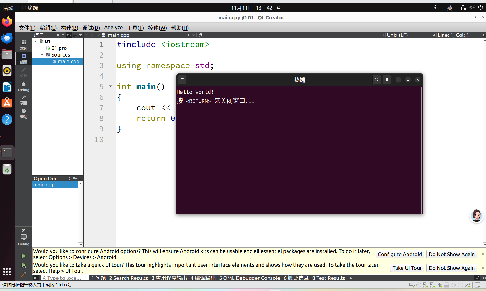
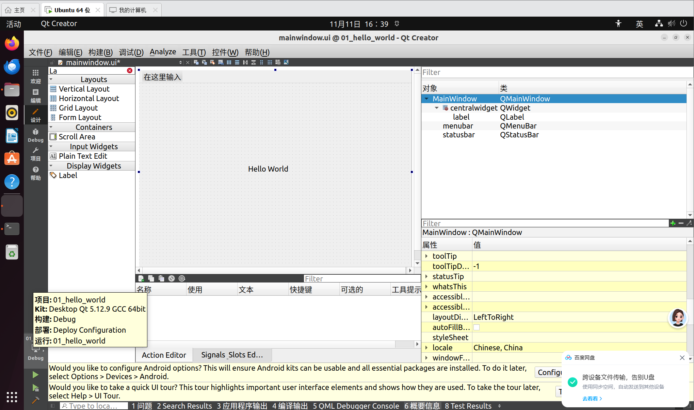
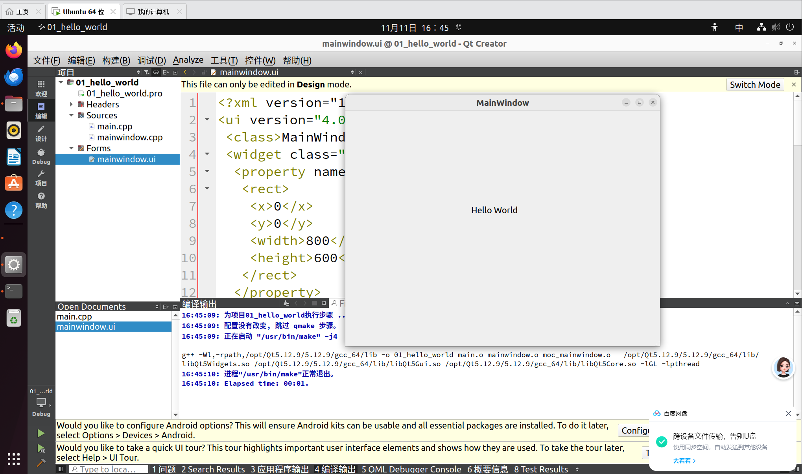
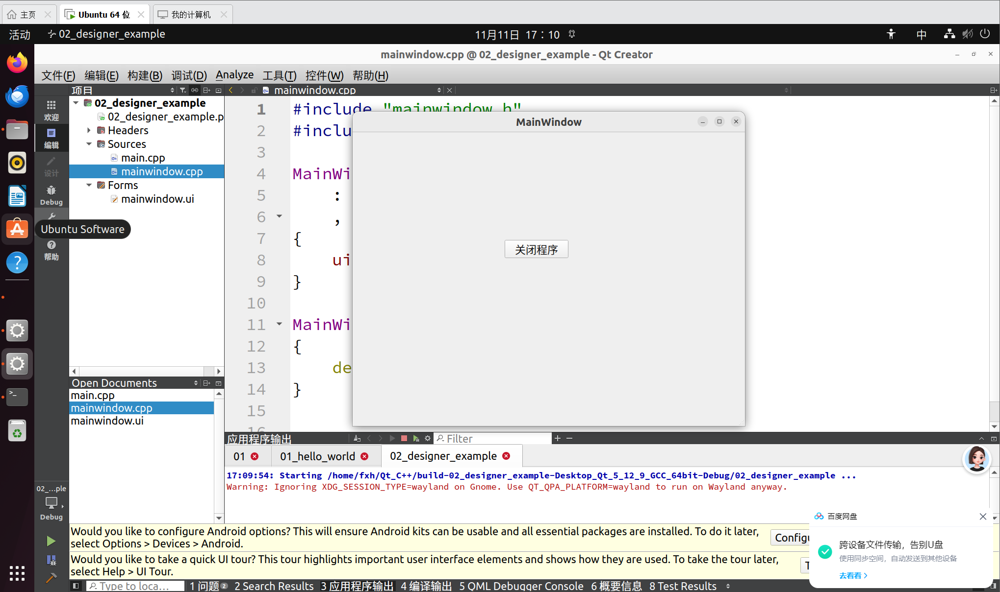
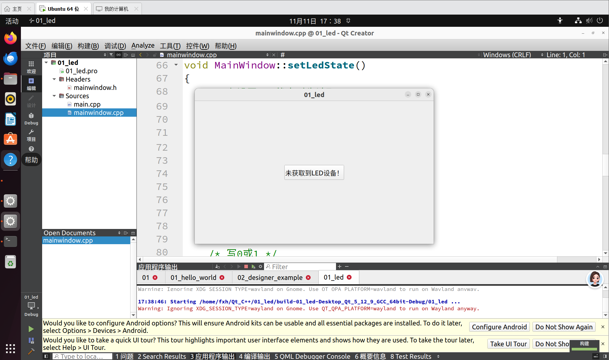

# Qt 界面程序实验

> 对应实践：
> C++ 基础语法回顾（iostream /cout/namespace）→ Qt Creator 新建 Widgets 项目 → Designer 拖拽 Label 做 Hello World → 查看 .ui 文件 XML 结构与编译链接过程 → Designer 添加按钮示例 → LED 控制界面雏
>
> 形。
> 核心链路：
> **C++ hello → 新建 Qt Widgets 项目 → Designer 拖控件 → 编译运行 → 按钮示例 → LED 界面雏形**
> 前置依赖：Ubuntu 已安装 Qt 5.12.9 与 Qt Creator；本章先在 Ubuntu 本地（Desktop Kit）跑通界面，交叉编译到开发板后续再做。


***

## 一、简介

### 1. Qt 是什么


* Qt 是一套跨平台 C++ 图形界面开发框架，一套代码可在 Ubuntu、Windows、ARM 开发板上运行，嵌入式 Linux 触摸屏界面常用。

* **Qt 与 Qt Creator 的区别**：Qt 是开发框架（库、头文件、API）；Qt Creator 是写代码、编译、调试的 IDE（编辑器）。

### 2. 本次实验环境


| 项       | 内容                                       |
| ------- | ---------------------------------------- |
| Qt 版本   | Qt 5.12.9                                |
| Kit（套件） | Desktop Qt 5.12.9 GCC 64bit（本地 x86 编译运行） |
| 构建模式    | Debug                                    |
| 运行平台    | Ubuntu 本地窗口                              |

> Kit（套件）= 编译器 + Qt 版本 + 调试器的一套组合配置；选哪个 Kit 决定程序编译成什么平台的可执行文件。

### 3. 启动 Qt Creator

终端里执行启动脚本，后台拉起 Qt Creator：


```
/opt/Qt5.12.9/Tools/QtCreator/bin/qtcreator.sh &
```

**命令逐段拆解：**


| 段                                | 含义                                                       |
| -------------------------------- | -------------------------------------------------------- |
| `/opt/Qt5.12.9/Tools/QtCreator/` | Qt Creator 的安装目录（和 Qt 库目录 `5.12.9/gcc_64/` 是分开的两处）       |
| `bin/qtcreator.sh`               | Qt Creator 启动脚本（`bin` = binary 可执行文件目录，`.sh` = shell 脚本） |
| `&`                              | 后台运行：把 Qt Creator 放到后台，终端不被占用，还能继续敲其他命令                  |

> 注意：路径开头是根目录斜杠 
>
> `/opt`
>
> ，不是 
>
> `./opt`
>
> ；
>
> `./`
>
>  表示当前目录下的相对路径，写成 
>
> `./opt`
>
>  会找不到文件。


***

## 二、C++ 语法回顾示例

### 1. 纯 C++ Hello World

先用 Qt Creator 建一个普通 C++ 控制台项目，回顾最基础的输入输出语法：


```
#include <iostream>
using namespace std;

int main()
{
    cout << "Hello World!" << endl;
    return 0;
}
```


| 代码                     | 作用                           |
| ---------------------- | ---------------------------- |
| `#include <iostream>`  | 引入标准输入输出头文件（对应 C 的 stdio.h）  |
| `using namespace std;` | 打开 std 命名空间，否则要写 `std::cout` |
| `cout << ... << endl;` | 标准输出，对应 C 的 `printf`         |




> 面向对象、类、命名空间原理等 C++ 进阶特性后续用到再补，本阶段能看懂上面这段即可。


***

## 三、Qt Widgets 项目（01\_hello\_world）

### 1. 项目文件结构

新建 **Qt Widgets Application**，项目目录下四类文件：


| 文件                                  | 作用                                            |
| ----------------------------------- | --------------------------------------------- |
| `xxx.pro`                           | 项目管理文件，告诉 qmake 编译哪些源文件、链接哪些库（相当于简易 Makefile） |
| `Headers/mainwindow.h`              | 主窗口类声明                                        |
| `Sources/main.cpp`、`mainwindow.cpp` | 程序入口与窗口类实现                                    |
| `Forms/mainwindow.ui`               | 界面文件，Designer 拖拽生成，XML 格式                     |

### 2. Designer 拖拽界面

进入「设计」模式，从左侧控件栏拖一个 **Label** 到窗口中央，把文字改成 `Hello World`。右侧对象树能看到窗口层级：`MainWindow → centralWidget → label / menubar / statusbar`。




### 3. .ui 文件本质是 XML

切回编辑模式打开 `mainwindow.ui`，可以看到它是一段 XML 描述：窗口类名、控件、窗口尺寸（800×600）都写在标签里，编译时由 Qt 工具自动转成 C++ 代码。


```
<ui version="4.0">
  <class>MainWindow</class>
  <widget class="QWidget" ...>
    <property name="geometry">
      <rect><x>0</x><y>0</y><width>800</width><height>600</height></rect>
    </property>
  </widget>
</ui>
```

### 4. 编译与运行

点构建运行，编译输出里可以看到 g++ 把目标文件链接到 Qt 库：`libQt5Widgets.so`、`libQt5Gui.so`、`libQt5Core.so`，进程正常退出后弹出 MainWindow 窗口显示 Hello World。





***

## 四、Designer 按钮示例（02\_designer\_example）

在 02\_designer\_example 项目里，用 Designer 往窗口拖一个 **PushButton**，文字设为「关闭程序」，通过信号与槽把按钮点击事件和窗口关闭动作绑定，运行后点击按钮即可退出程序。




> 信号（signal）= 控件发出的事件（如按钮 clicked 点击）；槽（slot）= 响应事件的函数。信号槽的底层机制后续章节展开，本阶段先会在 Designer 里拖拽绑定即可。


***

## 五、LED 控制界面雏形（01\_led）

01\_led 项目往实际功能靠：在 `mainwindow.cpp` 里封装 `setLedState()` 函数（注释标注「写 0 或 1」），界面按钮先提示「未获取到 LED 设备！」。




> 这一步只是界面与函数框架，真正操作 LED 要等后面接上字符设备驱动、通过 
>
> `/dev`
>
>  节点读写；当前先把 Qt 界面和函数骨架搭起来。


***

## 六、常见现象与坑


| 现象                                                 | 原因                                   | 处理                                        |
| -------------------------------------------------- | ------------------------------------ | ----------------------------------------- |
| 启动时警告 `Ignoring XDG_SESSION_TYPE=wayland on Gnome` | Ubuntu 桌面是 Wayland 会话，Qt 走了 X11 兼容模式 | 不影响本地运行，可忽略；开发板上不存在该问题                    |
| 编译找不到 Qt 库                                         | Kit 选错或 Qt 版本未装好                     | 确认左下角 Kit 为 `Desktop Qt 5.12.9 GCC 64bit` |
| .ui 里改了界面但窗口没变                                     | 没重新构建，或改的是 XML 源码没切回设计模式             | 重新 qmake + 构建再运行                          |


***

## 七、本章小结


1. Qt 是 C++ 界面框架，Qt Creator 是配套 IDE；Kit 决定编译目标平台。

2. Widgets 项目四类文件：`.pro`（项目管理）、`.h`（类声明）、`.cpp`（实现）、`.ui`（XML 界面描述）。

3. Designer 拖拽控件生成界面，`.ui` 编译时转成 C++；程序链接 Qt5Widgets / Qt5Gui / Qt5Core 三个核心库。

4. 信号 = 事件，槽 = 响应函数；本阶段先会拖拽绑定，底层机制后续再学。

5. LED 项目先搭界面与 `setLedState()` 骨架，后续再接字符设备驱动操作硬件。

**一句话概括**：C++ 语法回顾 → 新建 Widgets 项目 → Designer 拖 Label 出 Hello World → 看懂 .ui XML 与编译链接 → 按钮信号槽示例 → LED 界面雏形。


***

## 附：路径速查


| 内容            | 说明                                                              |
| ------------- | --------------------------------------------------------------- |
| Qt 库路径        | `/opt/Qt5.12.9/5.12.9/gcc_64/`                                  |
| Qt Creator 启动 | `/opt/Qt5.12.9/Tools/QtCreator/bin/qtcreator.sh &`（`&` 后台运行）    |
| Kit           | Desktop Qt 5.12.9 GCC 64bit                                     |
| 示例项目          | `01`（C++ hello）、`01_hello_world`、`02_designer_example`、`01_led` |
| 核心 Qt 库       | libQt5Widgets / libQt5Gui / libQt5Core                          |